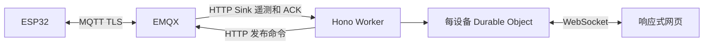

# 后续：MQTT 与 Cloudflare

远程调试仍为后续设计。固件已实现独立的 [MCU 温度 MQTT 遥测](mqtt-telemetry.md)，Worker 部署和远程鉴权尚未实现。串口 bridge 使用 Node.js 原生模块；Worker 可复用 Hono 与纯 TypeScript 协议包，不能部署本机串口代码。

设备复用原有 MQTT TLS 连接。`debug=true` 开启有期限的逻辑会话，调整遥测并接受受限命令，不额外建 ESP32 WebSocket。温湿度业务数据独立按周期发布，关闭 debug 不停止正常采集。

建议主题 `devices/{id}/telemetry`、`debug/events`、`commands`、`acks`。业务按需 QoS1，高频 debug 丢旧保新。命令和 ACK 关联 id / bootId / 期限；命令不 retained，旧指令不得重启后自动执行，QoS1 重复投递仍需设备去重。

Worker 校验浏览器身份、设备权限和会话，服务端调用 EMQX API。HTTP Sink 独立校验凭据、设备映射、大小和重放。管理 API key、设备密码及 REPL 不下发浏览器。每设备一个 Durable Object 协调订阅者，服务端使用可休眠 WebSocket，并可重建会话摘要。默认只保存最新状态和有限审计，不把全部高频遥测写数据库。

远程先以 LITE 为默认：1 Hz 状态、变更日志、按需屏幕、小范围 GPIO 元数据。按实机堆内存、耗时、TLS 断连和带宽测量再提高频率。USB FULL 上限不是远程性能保证。传输复用当前 envelope / ACK / revision / TTL，MQTT 层新增服务端身份与过期校验。

实施前核对实际 EMQX 版本、许可和网络。平台能力参考 [EMQX HTTP Sink](https://docs.emqx.com/en/emqx/latest/develop/data-integration/data-bridge-webhook.html)、[EMQX REST API](https://docs.emqx.com/en/emqx/latest/guides/api.html)、[Cloudflare DO WebSocket](https://developers.cloudflare.com/durable-objects/best-practices/websockets/)。当前未验证实际 broker 或云账号配置。
