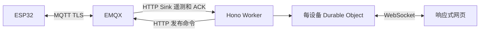

# 后续：MQTT 与 Cloudflare

远程调试仍为后续设计。固件已有独立的 [温度与环境 MQTT 遥测](mqtt-telemetry.md)：默认保留 MCU 内部温度路径，环境传感器通过私有 `.sensor.json` 显式启用。Worker 部署和远程鉴权尚未实现。串口 bridge 使用 Node.js 原生模块；Worker 可复用 Hono 与纯 TypeScript 协议包，不能部署本机串口代码。

本地环境驱动使用 UART1 RX14 / TX15、GPIO13 共用 DE 与 /RE，每 60 秒只发 `READ`；四字节发送期间优先以 1ms 轮询切回接收。环境采样不受 USB debug / 网页开关控制；关闭网页实时更新后，设备读取和 MQTT 可继续。最后读数带读取年龄和过期状态，页面暂停或失联不会被标为最新。

环境信封包含同轮 `temperature_c` / `humidity_pct` 和可选 MCU 温度，保留原读取 UTC，并固定每个指标的 `metric_sources`。无有效环境观察时不产生新信封；待确认消息仍只保留一条 RAM 副本，不具重启持久化。私有配置和 CA 不进 Git，TLS 继续严格验证 CA 与服务器主机名。

以下为远程方案：设备复用原有 MQTT TLS 连接。`debug=true` 开启有期限的逻辑会话，调整遥测并接受受限命令，不额外建 ESP32 WebSocket。温湿度业务数据独立按周期发布，关闭 debug 不停止正常采集。

建议主题 `devices/{id}/telemetry`、`debug/events`、`commands`、`acks`。业务按需 QoS1，高频 debug 丢旧保新。命令和 ACK 关联 id / bootId / 期限；命令不 retained，旧指令不得重启后自动执行，QoS1 重复投递仍需设备去重。

Worker 校验浏览器身份、设备权限和会话，服务端调用 EMQX API。HTTP Sink 独立校验凭据、设备映射、大小和重放。管理 API key、设备密码及 REPL 不下发浏览器。每设备一个 Durable Object 协调订阅者，服务端使用可休眠 WebSocket，并可重建会话摘要。默认只保存最新状态和有限审计，不把全部高频遥测写数据库。

远程先以 LITE 为默认：1 Hz 状态、变更日志、按需屏幕、小范围 GPIO 元数据。按实机堆内存、耗时、TLS 断连和带宽测量再提高频率。USB FULL 上限不是远程性能保证。传输复用当前 envelope / ACK / revision / TTL，MQTT 层新增服务端身份与过期校验。

本地 TLS 握手期间暂缓 bulk USB 分配、保留 ACK / TTL / 物理屏幕工作的优化正在实板验证，不构成长稳故障已全部解决的结论。现有证据包括历史 MCU 短测、三次临时环境读取，以及后续持续环境采样和六次 PUBACK；踢线后的旧版证书验证失败及独立精简测试的 DNS resolve 失败仍未通过恢复验收。24 小时门槛仍失败，未接入或验收下游 PG / Grafana。

当前实板仍使用 MicroPython 1.22.2，1.29.0 升级仅为计划，尚未刷写。现有 CA 不自动更新；后续升级和故障修复后需另立稳定窗口，不能沿用历史短测作为新版本成功证据。

远程实施前核对实际 EMQX 版本、许可和网络。平台能力参考 [EMQX HTTP Sink](https://docs.emqx.com/en/emqx/latest/develop/data-integration/data-bridge-webhook.html)、[EMQX REST API](https://docs.emqx.com/en/emqx/latest/guides/api.html)、[Cloudflare DO WebSocket](https://developers.cloudflare.com/durable-objects/best-practices/websockets/)。已验证的本地 MQTT 账号不能代替未来 HTTP Sink、命令权限或云账号配置验收。
